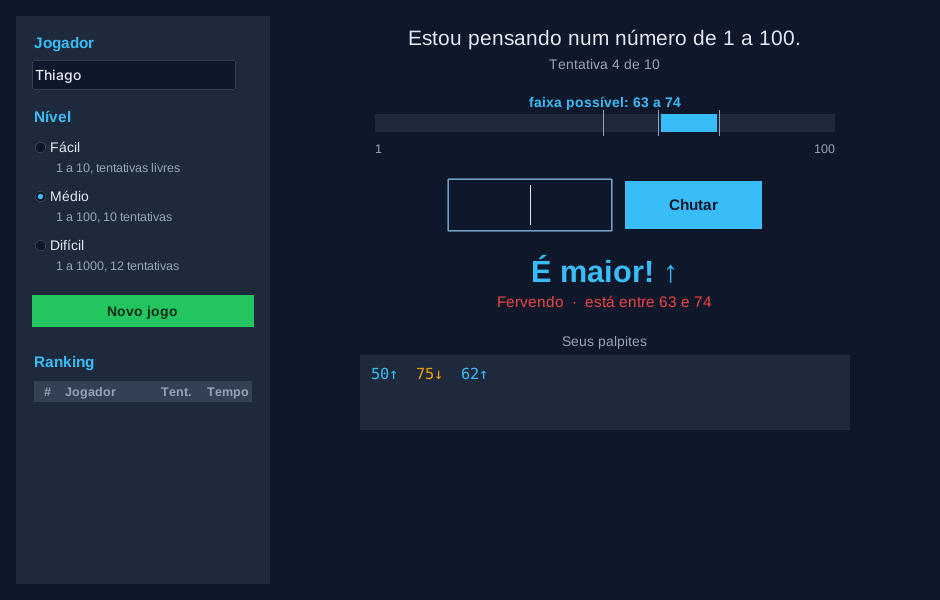
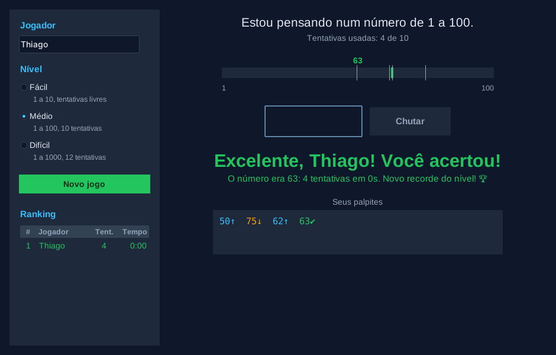

# Jogo de Adivinhação de Números

O computador pensa num número e você tenta adivinhar. A cada palpite, o jogo diz se o número secreto é **maior** ou **menor**. Tem três níveis de dificuldade, dicas de proximidade e ranking dos melhores jogadores. Funciona no **Windows, Linux e macOS** e não precisa instalar nenhuma biblioteca: só Python.

| Partida em andamento | Vitória |
|---|---|
|  |  |

## Como jogar

1. Digite seu nome e escolha o nível.
2. Digite um palpite e aperte **Enter** (ou clique em **Chutar**).
3. O jogo responde **"É maior! ↑"** ou **"É menor! ↓"** e mostra quão perto você está: *Frio*, *Morno*, *Quente* ou *Fervendo*.
4. A barra azul mostra a **faixa onde o número ainda pode estar**, e diminui a cada palpite.
5. Acertou? Seu resultado entra no ranking do nível. Aperte **Enter** de novo para jogar outra partida.

| Nível | Números | Tentativas |
|---|---|---|
| Fácil | 1 a 10 | sem limite |
| Médio | 1 a 100 | 10 |
| Difícil | 1 a 1000 | 12 |

> **Dica:** chutar sempre o meio da faixa possível (busca binária) garante o acerto em no máximo 7 tentativas no Médio e 10 no Difícil.

## Funcionalidades

- Três níveis, com limite de tentativas no Médio e no Difícil.
- Dica "maior/menor", termômetro de proximidade e barra com a faixa possível.
- Histórico dos palpites da partida, com setas coloridas.
- Palpites inválidos (texto, fora da faixa) ou repetidos não gastam tentativa.
- **Ranking** dos 10 melhores de cada nível, por número de tentativas e, no empate, pelo tempo. Fica salvo em `~/.jogo_adivinhacao.json`.

## Requisitos

- Python 3.9 ou mais novo, com Tkinter (já vem no instalador oficial do Windows e do macOS).
  - No Ubuntu/Debian, se faltar: `sudo apt install python3-tk`

## Como usar

```bash
git clone https://github.com/thi-araujo/NumberGuessingGame.git
cd NumberGuessingGame
python adivinhacao.py
```

No Linux/macOS, use `python3` no lugar de `python`.

## Estrutura do projeto

```
NumberGuessingGame/
├── adivinhacao.py      # interface gráfica (Tkinter)
├── jogo.py             # regras do jogo e ranking, sem interface
├── tests/
│   └── test_jogo.py    # testes automatizados
└── docs/               # capturas de tela usadas neste README
```

## Testes

```bash
python -m unittest discover -s tests -v
```

Os testes também confirmam que a estratégia de busca binária sempre vence no nível Difícil.

## Histórico

A primeira versão (julho de 2022) era um jogo de terminal com números de 1 a 10, dicas "mais alto/mais baixo" e pontuação mais alta. O código tinha problemas de indentação e estrutura e não chegava a rodar. Em 2026 o jogo foi refeito com interface gráfica, níveis de dificuldade, ranking salvo e testes, mantendo a mecânica original.

## Autor

**Thiago Gomes Araújo**: [GitHub](https://github.com/thi-araujo) · [Portfólio](https://thi-araujo.github.io)
